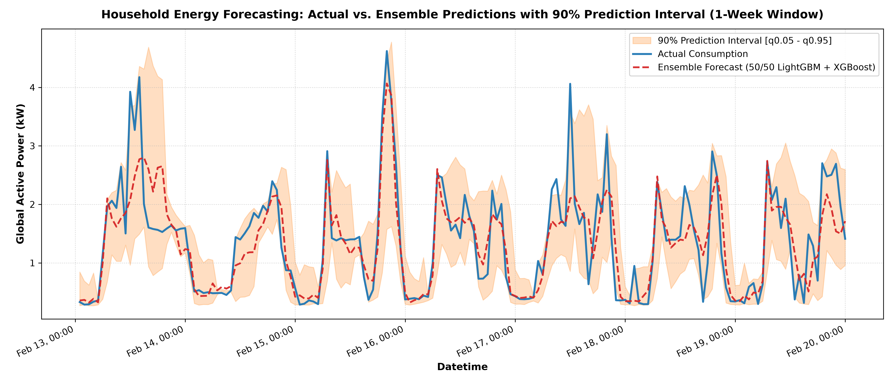
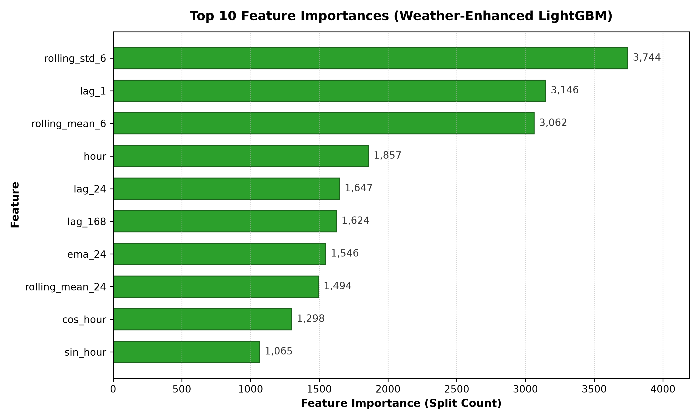

# ⚡ Household Energy Consumption Forecaster


> **An end-to-end, weather-aware, leak-free time-series forecasting pipeline for predicting household electricity demand, featuring calibrated prediction intervals and an interactive Streamlit dashboard.**

---

## 📑 Table of Contents

1. [Project Overview](#-project-overview)
2. [Dataset & Data Sources](#-dataset--data-sources)
3. [System Architecture](#-system-architecture)
4. [Data Preprocessing](#-data-preprocessing)
5. [Feature Engineering](#-feature-engineering)
6. [Modeling & Forecasting Methodology](#-modeling--forecasting-methodology)
7. [Data Leakage Prevention](#-data-leakage-prevention)
8. [Uncertainty Quantification](#-uncertainty-quantification)
9. [Model Benchmark & Results](#-model-benchmark--results)
10. [Visualizations & Deliverables](#-visualizations--deliverables)
11. [Project Directory Structure](#-project-directory-structure)
12. [Installation & Execution](#-installation--execution)
13. [Limitations & Considerations](#-limitations--considerations)
14. [License & Data Attribution](#-license--data-attribution)

---

## 🔭 1. Project Overview

Electricity demand forecasting is an important component of:

- Electrical grid balancing.
- Home Energy Management Systems (HEMS).
- Dynamic electricity tariff optimization.
- Household energy consumption monitoring.
- Demand-side energy management.

This project implements an end-to-end **Machine Learning and Deep Learning time-series forecasting framework**, using approximately four years of household electricity consumption telemetry (2006–2010).

The original consumption data comes from a household in Sceaux, France, and is sourced from the UCI Machine Learning Repository.

### Key Highlights

| Component | Implementation |
|---|---|
| Forecasting type | Time-series regression |
| Dataset | UCI Individual Household Electric Power Consumption |
| Weather integration | Open-Meteo Historical Weather API |
| Feature engineering | 31 non-leaking predictors |
| Primary models | LightGBM + XGBoost |
| Deep learning benchmark | PyTorch LSTM |
| Ensemble strategy | 50:50 weighted blend |
| Uncertainty estimation | 5th and 95th quantile regression |
| Evaluation strategy | Chronological 80:20 split |
| Deployment interface | Streamlit + Plotly |

### Final Model Performance

| Metric | Result |
|---|---:|
| R² Score | **0.7154** |
| MAE | **0.2646 kW** |
| RMSE | **0.3898 kW** |
| Empirical prediction interval coverage | **85.3%** |
| MAE improvement over baseline | **49.2%** |

---

## 📂 2. Dataset & Data Sources

### 2.1 Household Electricity Consumption

**Source:** UCI Machine Learning Repository

Dataset: Individual Household Electric Power Consumption.

- Approximately 2.07 million observations.
- Original sampling frequency: 1 minute.
- Observation period: December 2006 – November 2010.
- Geographic location: Sceaux, France.
- Target variable: `Global_active_power`.

### 2.2 Weather Data

**Source:** Open-Meteo Historical Weather API.

Historical weather variables are integrated using hourly timestamps.

| Feature | Description |
|---|---|
| `temperature_2m` | Ambient temperature at 2 metres |
| `relative_humidity_2m` | Relative humidity |
| `apparent_temperature` | Feels-like temperature |
| `precipitation` | Precipitation measurement |

Location: Sceaux, France (Latitude: 48.77, Longitude: 2.29).

---

## 🏗️ 3. System Architecture

The forecasting pipeline consists of four major stages.

```text
+------------------------------------------------------+
|                    RAW DATA SOURCES                  |
|                                                      |
|  UCI Electricity Data       Open-Meteo Weather API   |
|  2.07M one-minute rows      34,608 hourly records    |
+---------------------------+--------------------------+
                            |
                            v
+------------------------------------------------------+
|              1. DATA PREPROCESSING                   |
|                                                      |
|  - Delimiter parsing and missing-value treatment     |
|  - Sensor gap imputation                             |
|  - Timestamp alignment                               |
|  - Hourly aggregation                                |
+------------------------------------------------------+
                            |
                            v
+------------------------------------------------------+
|               2. FEATURE ENGINEERING                 |
|                                                      |
|  - Cyclical calendar features                        |
|  - Weather and degree-hour features                  |
|  - Autoregressive lag features                       |
|  - Rolling statistics and EMA                        |
|  - Public holiday indicators                         |
+------------------------------------------------------+
                            |
                            v
+------------------------------------------------------+
|             3. CHRONOLOGICAL TRAIN-TEST SPLIT        |
|                                                      |
|  Training: 27,536 hours (80%)                        |
|  Testing :  6,885 hours (20%)                        |
+---------------------------+--------------------------+
                            |
              +-------------+-------------+
              |                           |
              v                           v
+---------------------------+  +-----------------------+
|     POINT FORECASTING     |  | UNCERTAINTY ESTIMATION|
|                           |  |                       |
|  LightGBM Regressor       |  | LightGBM q = 0.05     |
|  XGBoost Regressor        |  | LightGBM q = 0.95     |
|                           |  |                       |
|  50:50 Weighted Ensemble  |  | Prediction intervals |
+-------------+-------------+  +-----------+-----------+
              |                            |
              +-------------+--------------+
                            |
                            v
+------------------------------------------------------+
|                 4. FINAL DELIVERABLES                |
|                                                      |
|  - Streamlit Interactive Dashboard                   |
|  - Forecast Evaluation Notebook                      |
|  - Actual vs Predicted Visualizations                |
|  - Feature Importance Analysis                       |
+------------------------------------------------------+
```

---

## 🧹 4. Data Preprocessing

The original one-minute electricity consumption telemetry is transformed into an hourly time-series dataset.

### Preprocessing Operations

1. **Delimiter parsing:** Reads the original semicolon-separated dataset.
2. **Missing-value treatment:** Converts `?` entries into NaN values.
3. **Gap imputation:** Applies forward-fill imputation to sensor gaps.
4. **Hourly aggregation:** Resamples the one-minute observations into hourly averages using:

```python
df.resample('h').mean()
```

5. **Weather alignment:** Merges historical weather observations with the corresponding hourly electricity consumption timestamps.

### Resulting Datasets

| Dataset | Approximate dimensions |
|---|---|
| Raw telemetry | 2.07 million one-minute records |
| Hourly electricity data | 34,589 records |
| Engineered dataset | 34,421 rows × 38 columns |

---

## 🧬 5. Feature Engineering

The project constructs 31 non-leaking predictors across seven categories.

| Category | Features | Purpose |
|---|---|---|
| Cyclical calendar | `sin_hour`, `cos_hour`, `sin_dayofweek`, `cos_dayofweek`, `sin_month`, `cos_month` | Represents recurring temporal patterns |
| Calendar indicators | `hour`, `dayofweek`, `quarter`, `month`, `year`, `is_weekend`, `is_holiday` | Captures calendar-based consumption behaviour |
| Weather | `temperature_2m`, `relative_humidity_2m`, `apparent_temperature`, `precipitation` | Captures weather-related demand variations |
| Degree hours | `heating_degree`, `cooling_degree` | Models heating and cooling requirements |
| Weather lags | `temp_lag_1`, `temp_lag_24` | Captures recent temperature trends |
| Autoregressive lags | `lag_1`, `lag_24`, `lag_168` | Captures historical electricity consumption |
| Rolling statistics | `rolling_mean_6`, `rolling_std_6`, `rolling_mean_24`, `rolling_std_24`, `rolling_mean_168`, `rolling_std_168` | Captures short-, medium- and long-term consumption dynamics |
| Exponential moving average | `ema_24` | Gives greater weight to recent observations |

### 5.1 Cyclical Calendar Encoding

Time variables exhibit recurring periodic behaviour.

Instead of treating hours, weekdays and months as purely linear variables, cyclical encoding represents them using sine and cosine transformations.

$$
\sin\left(\frac{2\pi t}{T}\right),
\qquad
\cos\left(\frac{2\pi t}{T}\right)
$$

Where:

- `t` = Current time index.
- `T` = Period length.

For example, hour-of-day uses `T = 24`.

### 5.2 Heating and Cooling Degree Hours

Two thermodynamic features are derived from ambient temperature.

**Heating Degree Hours:**

$$
HDH = \max(0,18-T)
$$

**Cooling Degree Hours:**

$$
CDH = \max(0,T-22)
$$

Where `T` represents ambient temperature in °C.

These features capture the increased electricity demand potentially associated with heating and cooling requirements.

### 5.3 Autoregressive Features

Historical consumption is used to capture temporal dependencies.

| Feature | Historical Reference |
|---|---|
| `lag_1` | Previous hour |
| `lag_24` | Same hour on the previous day |
| `lag_168` | Same hour on the previous week |

### 5.4 Rolling Statistics

Rolling means and standard deviations are calculated over:

- 6-hour windows.
- 24-hour windows.
- 168-hour windows.

An additional 24-hour Exponential Moving Average (EMA) is generated:

```python
df.ewm(span=24).mean()
```

---

## 🧠 6. Modeling & Forecasting Methodology

Three forecasting architectures are evaluated.

### 6.1 Target Transformation

Electricity consumption exhibits a right-skewed distribution, particularly during appliance usage spikes.

To stabilize variance, the target variable is transformed using `log1p`:

$$
y_{\text{log}} = \ln(1+y)
$$

Predictions are converted back to the original kW scale:

$$
\hat y = \exp(\hat y_{\text{log}})-1
$$

### 6.2 LightGBM Regressor

LightGBM is used as one of the primary gradient-boosting models.

| Hyperparameter | Value |
|---|---:|
| `num_leaves` | 31 |
| `learning_rate` | 0.02 |
| `n_estimators` | 1000 |
| `subsample` | 0.8 |
| `colsample_bytree` | 0.8 |

### 6.3 XGBoost Regressor

XGBoost serves as the second ensemble component.

| Hyperparameter | Value |
|---|---:|
| `max_depth` | 6 |
| `learning_rate` | 0.02 |
| `n_estimators` | 1000 |
| `tree_method` | `hist` |

### 6.4 Weighted Ensemble

The predictions from LightGBM and XGBoost are combined using equal weighting.

$$
\hat y_{\text{ensemble}}
=
0.50\hat y_{\text{LGBM}}
+
0.50\hat y_{\text{XGB}}
$$

This combines the predictive outputs of two different gradient-boosting implementations.

### 6.5 LSTM Neural Network

A two-layer Long Short-Term Memory (LSTM) network is implemented using PyTorch.

- Architecture: Two-layer LSTM.
- Input: 24-hour sliding sequences.
- Purpose: Benchmark recurrent deep learning against engineered tabular time-series models.

---

## 🛡️ 7. Data Leakage Prevention

One of the central design considerations is preventing target leakage.

Naive implementations of this dataset can achieve artificially inflated performance by including contemporaneous electrical measurements that are directly related to the target variable.

### 7.1 Excluded Variables

The following contemporaneous electrical measurements are excluded:

| Variable | Description |
|---|---|
| `Global_intensity` | Electrical current in amperes |
| `Voltage` | Electrical voltage |
| `Sub_metering_1` | Sub-circuit energy consumption |
| `Sub_metering_2` | Sub-circuit energy consumption |
| `Sub_metering_3` | Sub-circuit energy consumption |
| `Global_reactive_power` | Global reactive power |

Active electrical power is related to voltage, current and power factor:

$$
P=VI\cos(\phi)
$$

Consequently, including concurrent electrical measurements can provide the model with information that would not be available when making a genuine future forecast.

### 7.2 Leakage Prevention Strategy

**1. Explicit Feature Exclusion**

Contemporaneous electrical sensor readings are removed from the predictor matrix.

**2. Chronological Train-Test Split**

Random shuffling is avoided to preserve temporal ordering.

**3. Forward-Looking Predictions**

The model uses historical consumption, calendar variables, weather information and engineered features rather than future observations.

**4. Out-of-Time Evaluation**

The final 20% of observations are reserved for testing.

---

## 📈 8. Uncertainty Quantification

Point forecasts alone do not communicate the uncertainty associated with electricity demand predictions.

The project therefore implements quantile regression to estimate prediction intervals.

### 8.1 Quantile Regression

Two separate LightGBM models are trained:

| Model | Quantile | Purpose |
|---|---:|---|
| Lower-bound model | 0.05 | Estimates the 5th percentile |
| Upper-bound model | 0.95 | Estimates the 95th percentile |

The resulting interval is:

$$
[\hat y_{0.05},\hat y_{0.95}]
$$

### 8.2 Monotonicity Enforcement

Post-processing ensures that:

$$
\hat y_{\text{lower}}\geq 0
$$

$$
\hat y_{\text{lower}}\leq\hat y_{\text{upper}}
$$

### 8.3 Empirical Coverage

The nominal prediction interval is designed to cover 90% of possible observations.

However, the observed test-set coverage is:

**85.3%**

This indicates that the empirical coverage is below the nominal 90% target.

---

## 📊 9. Model Benchmark & Results

All models are evaluated on the final chronological test set.

**Test period:** 13 February 2010 – 26 November 2010.

**Test observations:** 6,885 hourly records.

### 9.1 Performance Comparison

| Rank | Model | MAE (kW) | RMSE (kW) | R² | Interval Coverage |
|---:|---|---:|---:|---:|---:|
| 1 | Tuned Weather Ensemble (LightGBM + XGBoost) | **0.2646** | **0.3898** | **0.7154** | **85.3%** |
| 2 | Tuned LightGBM (Weather + Log Target) | 0.2657 | 0.3926 | 0.7112 | 85.3% |
| 3 | Pure Time-Series LightGBM | 0.3178 | 0.4576 | 0.6077 | — |
| 4 | PyTorch 2-Layer LSTM | 0.3404 | 0.4863 | 0.5569 | — |
| 5 | Persistence Baseline (24h Lag) | 0.5210 | 0.7794 | -0.1380 | — |

### 9.2 Key Findings

**Ensemble vs. Baseline**

The ensemble reduces MAE by approximately 49.2%:

$$
\frac{0.5210-0.2646}{0.5210}\times100
\approx49.2\%
$$

RMSE is reduced by approximately 50%.

**Impact of Weather Features**

Adding weather variables increases R² from 0.6077 to 0.7154.

This represents an improvement of approximately 0.1077 in absolute R².

**Tree Ensembles vs. LSTM**

The gradient-boosting models outperform the two-layer LSTM on this particular engineered tabular time-series forecasting task.

The results suggest that carefully engineered temporal and weather features can be highly effective without requiring a more complex recurrent neural network.

---

## 🖼️ 10. Visualizations & Deliverables

### 10.1 Actual vs. Predicted Consumption

A one-week visualization comparing actual electricity demand against ensemble predictions.

The chart includes the lower and upper prediction bounds to demonstrate forecasting uncertainty.



### 10.2 Feature Importance

A top-10 feature importance visualization identifying the most influential predictors according to LightGBM split-based importance.



### 10.3 Interactive Streamlit Dashboard

**File:** `app.py`

The dashboard provides:

- Interactive date-range selection.
- Dynamic KPI tracking.
- Actual vs. predicted consumption charts.
- Prediction interval exploration.
- Interactive Plotly visualizations.

### 10.4 Additional Deliverables

| Artifact | Description |
|---|---|
| `app.py` | Interactive Streamlit dashboard |
| `eda_and_results.ipynb` | Exploratory analysis and evaluation notebook |
| `test_predictions.csv` | Out-of-time predictions and evaluation data |
| `actual_vs_predicted.png` | Forecast comparison visualization |
| `feature_importance.png` | Feature importance visualization |

---

## 📁 11. Project Directory Structure

```text
household_energy_forecaster/
│
├── .venv/
│
├── data/
│   ├── raw/
│   │   ├── individual_household_electric_power_consumption.zip
│   │   ├── household_power_consumption.txt
│   │   └── weather_sceaux.csv
│   │
│   └── processed/
│       ├── hourly_energy.csv
│       ├── engineered_energy.csv
│       └── test_predictions.csv
│
├── outputs/
│   ├── actual_vs_predicted.png
│   └── feature_importance.png
│
├── src/
│   ├── download_data.py
│   ├── fetch_weather.py
│   ├── preprocess.py
│   ├── feature_engineering.py
│   ├── train.py
│   ├── train_lstm.py
│   └── visualize.py
│
├── app.py
├── eda_and_results.ipynb
├── requirements.txt
└── README.md
```

### Directory Description

| Directory/File | Responsibility |
|---|---|
| `data/raw/` | Original electricity and weather datasets |
| `data/processed/` | Cleaned and engineered datasets |
| `outputs/` | Generated charts and visual artifacts |
| `src/` | Data processing, feature engineering and model training |
| `app.py` | Streamlit application |
| `eda_and_results.ipynb` | Exploratory analysis and model evaluation |
| `requirements.txt` | Python dependencies |

---

## 🚀 12. Installation & Execution

### Prerequisites

- Python 3.12
- pip
- Git
- Internet connectivity for data acquisition

### Step 1: Clone the Repository

```powershell
git clone <repository-url>
cd household_energy_forecaster
```

### Step 2: Create a Virtual Environment

```powershell
python -m venv .venv
```

Activate it using Windows PowerShell:

```powershell
.\.venv\Scripts\Activate.ps1
```

### Step 3: Install Dependencies

```powershell
python -m pip install --upgrade pip setuptools wheel

pip install -r requirements.txt
```

### Step 4: Execute the Data Pipeline

Run the scripts sequentially.

```powershell
# 1. Download and extract the original UCI dataset
python src/download_data.py

# 2. Fetch historical weather data
python src/fetch_weather.py

# 3. Preprocess and aggregate electricity telemetry
python src/preprocess.py

# 4. Generate engineered features
python src/feature_engineering.py
```

### Step 5: Train and Evaluate Models

```powershell
# Train LightGBM + XGBoost ensemble
# Generate quantile prediction intervals
python src/train.py

# Train the two-layer PyTorch LSTM benchmark
python src/train_lstm.py

# Generate visualizations and update the notebook
python src/visualize.py
```

### Step 6: Launch the Dashboard

```powershell
streamlit run app.py
```

Open the following address in your browser:

```text
http://localhost:8501
```

---

## ⚠️ 13. Limitations & Considerations

The following considerations are relevant when interpreting the results or extending the project.

1. **Single-household dataset:** The original dataset represents one household in France. Generalization to other households, regions and countries requires additional validation.

2. **Historical weather vs. operational weather:** Historical weather observations are not equivalent to weather forecasts. A real deployment must use weather forecasts available at prediction time.

3. **Prediction interval calibration:** The observed coverage of 85.3% is below the nominal 90%. Further calibration may improve uncertainty estimates.

4. **Temporal validation:** A single chronological holdout evaluates one historical period. Rolling-origin or walk-forward validation would provide a more comprehensive assessment.

5. **Feature availability:** Every predictor must be available at the actual forecast issuance time. Rolling statistics and lag features must be calculated without incorporating future observations.

6. **Historical data limitations:** Household behaviour, appliance usage and electricity consumption patterns can change over time, potentially causing model drift.

---

## 📜 14. License & Data Attribution

### License

This project is distributed under the **MIT License**.

See [`LICENSE`](LICENSE) for details.

### Data Sources

- **Electricity Consumption:** [UCI Machine Learning Repository – Individual Household Electric Power Consumption](https://archive.ics.uci.edu/dataset/235/individual+household+electric+power+consumption)
- **Weather Data:** [Open-Meteo Historical Weather API](https://open-meteo.com/)

---

**Built with Python, Machine Learning, Deep Learning and Time-Series Forecasting.**
